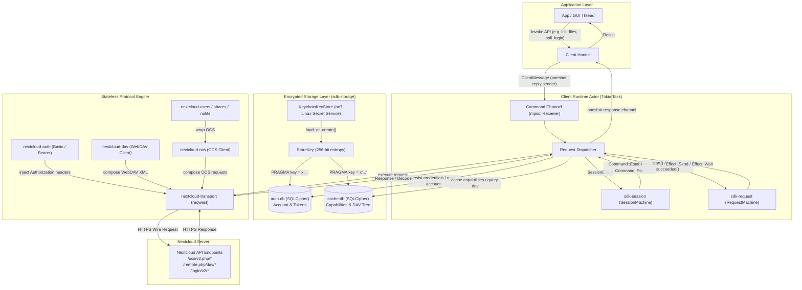

# Nextcloud Rust SDK — Architecture

The `nextcloud-rust-sdk` project is a high-performance, memory-safe Rust client for Nextcloud instances. It is architected as a Cargo workspace composed of focused, modular libraries adhering to strict separation of concerns, explicit interface boundaries, and compile-time correctness guarantees.

---

## 1. Workspace Organization

The workspace is organized into two primary layers:
1. **Stateless Core & Protocol Layer (`crates/core/` and `crates/nextcloud/`)**: Pure domain models, protocol codecs, HTTP transport seams, and pure state machines.
2. **Stateful SDK Facade & Runtime Layer (`nextcloud-rust-sdk` and `sdk-storage`)**: An actor-based orchestrator coordinating request dispatch, retry semantics, session lifecycles, and dual encrypted SQLCipher storage.

```
nextcloud-rust-sdk/
├── Cargo.toml                              # Workspace manifest
├── src/                                    # Top-level client facade
│   └── lib.rs
├── docs/                                   # Architectural & operational documentation
│   ├── ARCHITECTURE.md
│   ├── GETTING_STARTED.md
│   ├── SECURITY_AND_STORAGE.md
│   └── API_REFERENCE.md
├── crates/
│   ├── core/
│   │   ├── sdk-core/                       # HTTP abstractions, ApiPath, Transport & AuthProvider traits
│   │   ├── sdk-session/                    # Login Flow v2 & session lifecycle state machine
│   │   ├── sdk-request/                    # Per-call retry, backoff, and failure state machine
│   │   ├── sdk-storage/                    # Dual SQLCipher encrypted persistence & key store
│   │   ├── sdk-keyring/                    # Multi-platform keyring (Linux/Flatpak oo7, macOS Keychain, WinCred)
│   │   ├── sdk-ratelimit/                  # Bandwidth rate limiting, token-bucket traffic shaping & progress
│   │   ├── sdk-vfs/                        # Transient virtual tree, node metadata, and thumbnail cache
│   │   └── sdk-fuse/                       # Desktop FUSE filesystem driver for transient mounts
│   └── nextcloud/
│       ├── nextcloud-auth/                 # Basic, Bearer, Anonymous credentials & SecretString
│       ├── nextcloud-transport/            # reqwest implementation of Transport
│       ├── nextcloud-ocs/                  # OCS v1/v2 envelope parser and mutation engine
│       ├── nextcloud-dav/                  # WebDAV file & directory operations, PROPFIND XML engine
│       ├── nextcloud-uploads/              # WebDAV Chunked Uploads v2 streaming client
│       ├── nextcloud-users/                # Server capabilities & user provisioning API
│       ├── nextcloud-shares/               # OCS file sharing & public links API
│       ├── nextcloud-notifications/        # Notifications v2 API & actions
│       ├── nextcloud-activity/             # Activity v2 streams & filter queries
│       ├── nextcloud-deck/                 # Nextcloud Deck Kanban boards, stacks, and cards
│       ├── nextcloud-talk/                 # Nextcloud Talk (Spreed) chat conversations and rooms
│       ├── nextcloud-preview/              # Nextcloud thumbnail and preview generation
│       ├── nextcloud-trashbin/             # WebDAV trashbin management and restoration
│       ├── nextcloud-versions/             # WebDAV file version history and restoration
│       ├── nextcloud-goa/                  # GNOME Online Accounts desktop D-Bus integration
│       ├── nextcloud-kaccounts/            # KDE Plasma Online Accounts (Accounts-SSO) integration
│       └── nextcloud-client-config/        # Official desktop client profile parser across OSes
```

---

## 2. Stateless Layers vs. Stateful Layer

The architecture enforces a strict architectural boundary between **stateless protocol engines** and the **stateful client manager**.

```
+---------------------------------------------------------------------------------------+
|                                    Stateless Layer                                    |
|                                                                                       |
|   +-----------------------+     +------------------------+     +------------------+   |
|   | nextcloud-dav         |     | nextcloud-shares       |     | nextcloud-users  |   |
|   | (WebDAV CRUD, XML)    |     | (OCS Shares v1)        |     | (Capabilities)   |   |
|   +-----------------------+     +------------------------+     +------------------+   |
|   +-----------------------+     +------------------------+     +------------------+   |
|   | nextcloud-notifs      |     | nextcloud-activity     |     | nextcloud-ocs    |   |
|   | (Notifications v2)    |     | (Activity v2 Feed)     |     | (OCS Envelope)   |   |
|   +-----------------------+     +------------------------+     +------------------+   |
|                                                                                       |
|   [sdk-core] Transport trait  /  AuthProvider trait  /  Request & Response envelopes  |
|   [nextcloud-transport] reqwest engine   |   [nextcloud-auth] SecretString / Basic /  |
|                                                               Bearer credentials      |
+---------------------------------------------------------------------------------------+
                                           |
                                    driven by / uses
                                           v
+---------------------------------------------------------------------------------------+
|                                    Stateful Layer                                     |
|                                                                                       |
|   +-------------------------------------------------------------------------------+   |
|   | nextcloud-rust-sdk Facade Client & Background Worker                          |   |
|   |                                                                               |   |
|   |   +--------------------------+           +--------------------------------+   |   |
|   |   | sdk-session              |           | sdk-request                    |   |   |
|   |   | SessionMachine           |           | RequestMachine                 |   |   |
|   |   | - Login Flow v2          |           | - Retry budgets                |   |   |
|   |   | - Token polling          |           | - Exponential backoff          |   |   |
|   |   | - Reauth detection       |           | - Failure classification       |   |   |
|   |   +--------------------------+           +--------------------------------+   |   |
|   |                                                                               |   |
|   |   +-----------------------------------------------------------------------+   |   |
|   |   | sdk-storage                                                           |   |   |
|   |   | - KeyStore / KeychainKeyStore (oo7 Linux Keyring / Secret Service)    |   |   |
|   |   | - EncryptedDatabase (SQLCipher 256-bit AES-GCM)                       |   |   |
|   |   |   ├── auth.db  (Account tokens, login flow state)                     |   |   |
|   |   |   └── cache.db (Server capabilities, WebDAV metadata cache)           |   |   |
|   |   +-----------------------------------------------------------------------+   |   |
|   +-------------------------------------------------------------------------------+   |
+---------------------------------------------------------------------------------------+
```

### The Stateless Layers

Every crate in `crates/nextcloud/` as well as `sdk-core` is purely stateless:
- **No internal mutable runtime state**: Clients such as `DavClient`, `OcsClient`, `UserClient`, `ShareClient`, `NotificationClient`, and `ActivityClient` borrow the `Transport` and `AuthProvider` by reference or value without maintaining connection states, token refreshes, or locks.
- **Seam abstractions (`sdk-core`)**:
  - `Transport`: An asynchronous trait abstracting HTTP execution (`execute(&self, req: Request) -> Future<Output = Result<Response, Error>>`).
  - `AuthProvider`: Modifies outbound request `Headers` (e.g. injecting `Authorization: Basic ...` or `Authorization: Bearer ...`).
- **Deterministic and isolated**: Can be instantiated on ephemeral threads, embedded in test mocks, or executed concurrently across multi-threaded Tokio runtimes with zero shared lock contention.
- **Zero I/O State Machines (`sdk-session` & `sdk-request`)**: Even the state machines are pure transition functions (`handle(event) -> Result<Command, SessionError>` and `failed(failure) -> Effect`). They perform zero I/O, sleep zero timers, and log no external telemetry, ensuring 100% testability with unit tests.

### The Stateful Layer

The top-level client (`nextcloud-rust-sdk`) provides the cohesive developer surface:
- **Actor-based orchestration**: An asynchronous worker loop runs on a dedicated Tokio task, communicating with client handles over bounded MPSC channels (`tokio::sync::mpsc`).
- **Encrypted Local Persistence (`sdk-storage`)**: Dual SQLCipher SQLite databases secure local information at rest:
  - `auth.db`: Accounts, app passwords, active login flow tokens.
  - `cache.db`: Server capabilities, WebDAV directory hierarchies, user metadata.
- **Automated Lifecycle Recovery**: When requests fail with `401 Unauthorized`, the session state machine switches to `ReauthRequired`, signaling the application to initiate re-authentication without dropping pending queue requests.
- **Policy-driven Retries**: Every outbound request passes through `RequestMachine`, observing configurable retry policies (e.g., exponential backoff, jitter, maximum attempt bounds) before reporting errors back to the caller.

---

## 3. Data Flow and Communication Architecture

The following diagram illustrates the lifecycle of client operations, channel message passing between caller handles and the worker actor, state transitions, and disk encryption boundaries:



---

## 4. Concurrency and Thread Safety Guarantees

1. **`Send + Sync + 'static`**: All client handles and domain models implement `Send + Sync + 'static`, permitting trivial usage across Tokio tasks and multi-threaded runtimes.
2. **Channel Isolation**: Mutating state (session tokens, login poll flows, database write transactions) is strictly isolated within the background actor task. Caller threads hold lightweight clonable handles backed by MPSC request channels and oneshot return channels.
3. **No Lock Contention**: Because state machines and SQLite connection handles live within the worker actor, caller threads never block on mutexes or database row locks.
4. **Compile-Time Memory Safety**: The entire codebase enforces `#![forbid(unsafe_code)]` and `#![deny(missing_docs)]`. Data races and null pointer dereferences are mathematically prevented by the Rust type system.
